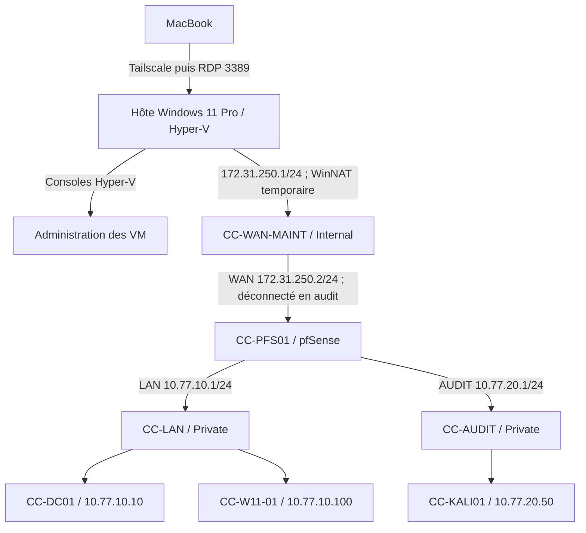

# Architecture cible

Référence : dossier de conception CyberCorp v1.0, pages 5 à 10. Cette page décrit une cible de laboratoire, pas un déploiement constaté.

## Zones et accès

| Zone | Type Hyper-V | Adresse de la passerelle | Machines admises | Interface de l’hôte |
| --- | --- | --- | --- | --- |
| `CC-LAN` | Private | pfSense `10.77.10.1/24` | pfSense LAN, DC, client | Aucune |
| `CC-AUDIT` | Private | pfSense `10.77.20.1/24` | pfSense AUDIT, Kali | Aucune |
| `CC-WAN-MAINT` | Internal | hôte `172.31.250.1/24` | pfSense WAN seulement | `172.31.250.1/24`, sans passerelle |

Le DC, le client et Kali ont chacun **une seule carte réseau**. Aucun d’eux ne se connecte à un commutateur External ou au Default Switch. L’hôte et le MacBook ne rejoignent pas le domaine de laboratoire. Aucun sous-réseau des VM n’est annoncé dans Tailscale. L’adresse Tailscale existante de l’hôte n’est pas définie ici.

## Modes d’exploitation

- **Métier** : pfSense + DC + client = 9 Go de RAM VM.
- **Audit serveur** : pfSense + DC + Kali = 7 Go ; carte WAN pfSense déconnectée.
- **Audit client** : pfSense + client + Kali = 7 Go ; DC arrêté, donc pas de validation d’une nouvelle authentification AD.
- **Restauration** : pfSense + DC ou clone isolé = 5 Go.

Ne pas démarrer les quatre VM simultanément sur l’hôte prévu de 16 Go. Mesurer la mémoire disponible avant chaque séance ; le dossier prévoit au moins 1,5 Go de marge pour l’hôte.

## Frontières de sécurité

1. **Audit** : déconnecter la carte WAN de `CC-PFS01` dans Hyper-V, vérifier les cartes et les routes, puis démarrer Kali. Les règles AUDIT de pfSense n’ouvrent que la cible et les ports du scénario, pendant une durée définie ; le reste est refusé et journalisé.
2. **Maintenance** : arrêter Kali et déconnecter sa carte, connecter le WAN pfSense au seul `CC-WAN-MAINT`, activer temporairement WinNAT, limiter les sorties aux mises à jour nécessaires et bloquer l’accès à l’hôte et aux réseaux non publics. Revenir ensuite en mode audit et exporter la configuration effective.
3. **Administration distante** : MacBook → Tailscale → RDP de l’hôte → consoles Hyper-V. Ni pfSense ni les VM ne publient de port entrant depuis le WAN.

Le trafic DC ↔ client reste sur `CC-LAN` et ne traverse pas pfSense ; les ACL, GPO et pare-feu Windows assurent les contrôles locaux. Le NAT n’est pas une preuve d’isolation. Avant toute configuration du WAN, vérifier les routes existantes et l’absence de chevauchement de sous-réseaux.

## Identités et mots de passe

La forêt est `ad.cybercorp.test` (`CYBERCORP`). Le DC reste dans l’OU native `Domain Controllers`. Les utilisateurs métier vont dans `OU=CyberCorp/OU=Utilisateurs/<service>`, le poste dans `OU=Postes`, les comptes dédiés dans `OU=Admins` et les comptes de scénario dans `OU=Tests`.

Les 25 comptes fictifs et les comptes techniques figurent dans `config/comptes.csv`. Les secrets initiaux sont uniquement dans `secrets/initial-passwords.csv`, ignoré par Git. Le secret DSRM est distinct du secret du compte Administrator du domaine ; le compte local de secours du client et le compte pfSense ont chacun un secret différent. Les comptes `tst.*` restent désactivés hors séance.
