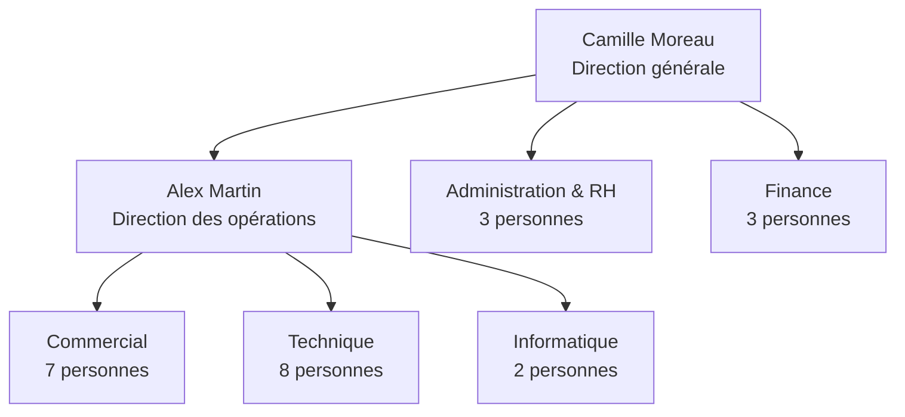

# Organigramme fictif CyberCorp

Les 25 personnes ci-dessous sont fictives. Les identifiants reprennent les comptes métier prévus dans `config/comptes.csv` ; les comptes `adm.*`, `tst.*` et les comptes techniques ne représentent pas des salariés supplémentaires.

| Service | Identifiant | Personne fictive | Fonction |
| --- | --- | --- | --- |
| Direction | `usr.dir01` | Camille Moreau | Direction générale |
| Direction | `usr.dir02` | Alex Martin | Direction des opérations |
| Administration & RH | `usr.rh01` | Nora Bernard | Responsable administration & RH |
| Administration & RH | `usr.rh02` | Lina Petit | Chargée RH |
| Administration & RH | `usr.rh03` | Hugo Laurent | Assistant administratif |
| Finance | `usr.fin01` | Sarah Dubois | Responsable finance |
| Finance | `usr.fin02` | Inès Michel | Contrôle de gestion |
| Finance | `usr.fin03` | Tom Garnier | Comptabilité |
| Commercial | `usr.com01` | Jade Lefebvre | Responsable commercial |
| Commercial | `usr.com02` | Mehdi Rousseau | Chargé de comptes |
| Commercial | `usr.com03` | Emma Fontaine | Chargée de comptes |
| Commercial | `usr.com04` | Adam Chevalier | Développement commercial |
| Commercial | `usr.com05` | Zoé François | Développement commercial |
| Commercial | `usr.com06` | Yanis Legrand | Relation clients |
| Commercial | `usr.com07` | Chloé Gauthier | Relation clients |
| Technique | `usr.tech01` | Lucas Perrin | Responsable technique |
| Technique | `usr.tech02` | Manon Robin | Architecte systèmes |
| Technique | `usr.tech03` | Sami Girard | Ingénieur infrastructure |
| Technique | `usr.tech04` | Léa André | Ingénieure infrastructure |
| Technique | `usr.tech05` | Noé Mercier | Consultant sécurité |
| Technique | `usr.tech06` | Aya Faure | Consultante sécurité |
| Technique | `usr.tech07` | Paul Nicolas | Technicien projets |
| Technique | `usr.tech08` | Maëlle Caron | Documentation technique |
| Informatique | `usr.it01` | Raphaël Henry | Administrateur systèmes |
| Informatique | `usr.it02` | Salomé Renaud | Support informatique |

Les responsables sont choisis pour la cohérence du scénario. Cette structure ne change pas la matrice des droits définie dans le dossier de conception : les accès sont accordés par groupes de métier et non par la position dans cet organigramme.
