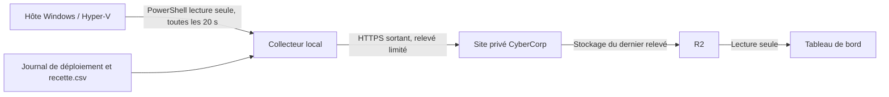

# Suivi du laboratoire sur le site privé

Le tableau de bord est accessible à l’adresse `https://cybercorp-vitrine.fabled-haven-3189.chatgpt.site/tableau-de-bord`. Le site reste privé et demande une connexion ChatGPT autorisée. Il montre les serveurs, les VM, les commutateurs et le **dernier relevé reçu**. Le collecteur envoie un relevé toutes les 20 secondes et la page recherche une mise à jour toutes les 5 secondes tant qu’elle est visible. Le délai normal d’affichage d’un changement est donc de quelques secondes à environ 25 secondes. Après 60 secondes sans relevé, la page signale que les données sont anciennes. Il n’y a pas de commande distante ni de flux continu depuis les VM.

## Circuit des données

Le collecteur `scripts/collect-dashboard.ps1` lit uniquement les VM CyberCorp et les commutateurs nommés dans sa liste blanche. Il envoie l’état, la mémoire affectée et le nombre de points de contrôle, la mémoire disponible de l’hôte, les dix étapes du journal et le nombre de tests marqués `Validé` dans `config/recette.csv`. Il n’envoie pas les IP personnelles, journaux Windows, noms de compte, contenus des disques ou secrets. Le site ne propose aucune commande de démarrage, d’arrêt ou de configuration des VM.

L’API `POST /api/telemetry` vérifie une clé propre au collecteur, refuse les VM inconnues et stocke seulement les champs prévus. L’accès au site privé ajoute une seconde barrière pour les appels sans navigateur. Les deux jetons du collecteur sont protégés par DPAPI dans `%LOCALAPPDATA%\CyberCorp\dashboard-collector.dpapi.json`, pour le compte Windows qui exécute la tâche. Ils ne sont pas dans Git ni dans le code du site. Le secret de validation côté site est une variable d’environnement protégée.

## Actualisation

L’agent local `scripts/dashboard-agent.ps1` lance le collecteur toutes les 20 secondes et écrit le résultat du dernier passage dans `%LOCALAPPDATA%\CyberCorp\collector-last-run.log`. `scripts/enable-dashboard-hyperv.ps1` ajoute le compte Windows au groupe local **Administrateurs Hyper-V** et démarre immédiatement l’agent en session élevée. L’entrée utilisateur `CyberCorpDashboardCollector` relance l’agent à la prochaine ouverture de session, une fois le nouveau groupe présent dans le jeton Windows. Le résultat de l’installation est écrit dans `%LOCALAPPDATA%\CyberCorp\dashboard-hyperv-install.log`. L’appartenance à ce groupe autorise aussi la gestion des VM ; il faut donc réserver ce compte aux personnes de confiance.

Une collecte manuelle se lance avec `pwsh -File scripts/collect-dashboard.ps1` depuis une session autorisée à lire Hyper-V à la racine du dépôt ; `-DryRun` affiche le relevé sans l’envoyer. Pour arrêter durablement la collecte automatique, supprimer l’entrée utilisateur `CyberCorpDashboardCollector` puis arrêter le processus PowerShell de l’agent.

Avant une nouvelle ouverture de session, une session PowerShell non élevée de ce compte ne peut pas lire Hyper-V : l’envoi continue pour la mémoire de l’hôte et l’avancement, mais les listes de VM et de commutateurs restent indisponibles. Le journal du collecteur doit indiquer `Hyper-V : ok` après le démarrage de l’agent élevé. Ne pas ouvrir les réseaux privés des VM vers le site.

Le suivi des tests est volontairement explicite : mettre à jour `config/recette.csv` après chaque recette vérifiée, avec un lien ou une référence de preuve non sensible. L’état d’avancement provient du tableau « État des étapes » du journal. Les données ne sont pas mises à jour lorsque l’hôte est éteint ou la session du compte fermée.
